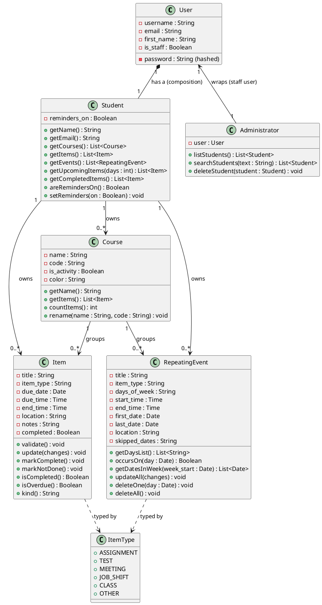

# Campus Hub — UML Class Diagram

Following the Week 5 UML lecture (class diagrams, + public / − private / # protected, associations). Built from the actual classes in this repo (planner/models/), labeled in the code as UML CD-1 (Student, Administrator) and CD-2 (Course, Item, RepeatingEvent). Paste the PlantUML into draw.io or Lucidchart to render it.

Relationships in words: a Django User has exactly one Student profile (composition); an Administrator is a staff User who can list, search, and delete student accounts (US-12); a Student owns many Courses, Items, and RepeatingEvents; a Course groups many Items and RepeatingEvents (the link is optional); Item and RepeatingEvent are both typed by ItemType.
